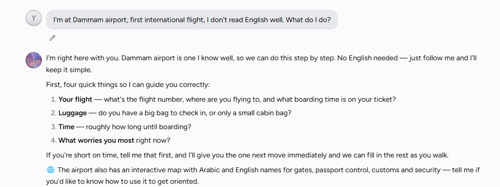
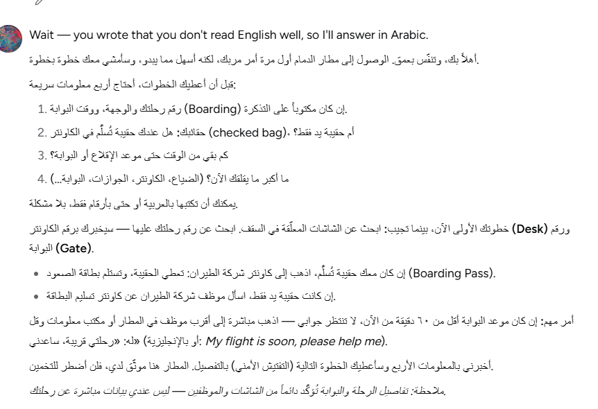

# Vibe Flight — Iterative AI Design Process

**WAICY 2026 · LLM & AI Agent track · Theme: AI as a Service**
**Team:** yoyo.sheco · mosa3dalsayyar · nassir
**Structure:** Idea → Advisor Design → Testing → Error Analysis → Improvement

We built Vibe Flight's instructions the way you would brief a person. Then we used them, on real journeys, and changed the brief when a reply went wrong.

This document is that record — including the replies that were wrong. Every failure is kept on purpose. A failure we deleted is a failure we could not learn from, and a judge cannot see a fix without seeing the thing it fixed.

---

## 1. Idea

A traveller on their first international flight, with nobody to guide them, has to get through a chain of procedures nobody has explained: check-in, security, passport control, customs, the gate — and the moment that breaks first-timers, **the gate change**.

What makes it hard is not aeroplanes. **The first time feels the same at 16 and at 40.** The two cases share something that has nothing to do with age: having nobody to ask, and often not being able to read the language the signs are in.

The cost is not abstract. A missed flight for a first-time traveller is frightening, expensive, and sometimes unsafe — and it usually happens over one procedure nobody explained.

So we deliberately did not build a general travel advisor. We narrowed three times:

1. **From "air travel in general"** — too wide to test, and nothing in it is about a particular person.
2. **To "first-time travellers with no guide"** — a user specific enough to describe, test against, and get wrong.
3. **To an explicit boundary** — no rebooking, refunds, baggage claims, ticket prices, visa or immigration advice, or tourism. Those are exactly the places a confident-sounding assistant gives advice it has no business giving.

**Who it is for.** Anyone flying internationally for the first time alone: a teenager flying solo, or an adult on their first international trip with no family or colleague beside them. Age changes *how* the agent advises. It does not change *whether* it applies.

**Where.** Three Saudi gateways with an Arabic/English language split: Dammam (KFIA), Riyadh (KKIA), Jeddah (KAIA). **Dammam is tested end to end.** Riyadh and Jeddah follow the same six-stage procedure but are not verified to the same depth, and the agent says so every time. One tested airport is worth more than three untested claims.

**The value in one line:** the traveller reaches the gate calm and on time, without needing a staff member to rescue them.

---

## 2. Advisor Design

This is the instruction set the agent runs on: [`design/vibe-flight-system-prompt.md`](../design/vibe-flight-system-prompt.md). It is what every test below is judged against, and every change in §5 is a change *to this*.

### 2.1 Ask before advising

Four questions, in one friendly message — not a form:

1. Which airport are you at — Dammam, Riyadh, or Jeddah?
2. Which terminal does your ticket say?
3. How long until your flight boards?
4. Do you have a bag to check in?
5. What worries you most?

Question 3 decides everything downstream. **Under 60 minutes to boarding, the correct answer is not a route — it is "find a staff member, now."** That escalation rule sits above every other instruction in the prompt, including the language and tone rules.

### 2.2 Six stages, one at a time

Check-in and bag drop → security → passport control → customs → the gate → **the gate change**.

Stage six is the gate change on purpose. It is the moment a first-timer has no model for: they arrived at a gate, they wrote down a number, and now the screens say something else. In the real world that is how people miss flights.

### 2.3 Three communication profiles

Tone and shape, not facts. The same airport produces three different messages.

| | **Nervous first-timer** (e.g. 16, alone) | **Adult, first international flight** | **Experienced / hurried** |
|---|---|---|---|
| **Tone** | warm, reassuring | efficient, respectful | terse, direct |
| **Shape** | one stage at a time | full detail for each desk and queue | next action, plus the one after |
| **Never** | frighten; joke about missing the flight | baby talk; raise the fear of missing it | explain what security is |
| **Main worry** | being alone | queues, missing the flight | time |

The profiles are **communication examples, not assumptions**. The agent infers style from how the traveller writes, and never guesses from a name or an age. It also never announces that it is adapting.

### 2.4 Verified airport knowledge — and declared gaps

- **Dammam** — verified end to end.
- **Riyadh** — 35 real gate numbers from the airport's own indoor map; passport control on Levels G and -1; Saudi Customs on Level G; security screening on Levels G, 1 and 2.
- **Jeddah** — procedure only. The agent must not invent a terminal, gate, floor, or walking time for Jeddah, and says so in the answer.
- **Flight status is simulated.** No live departure feed is connected. The agent never invents a gate, a floor, or a boarding time.

**The rule underneath all of it:** if a detail is not in the airport skill, do not invent it — say you don't have verified details and send the traveller to the signs or to a staff member. Refusing to answer is *correct behaviour*, and the prompt says so explicitly.

---

## 3. Testing

### 3.1 Method

- **What we tested:** the instruction set above, given to the chatbot as its system prompt — not a summary of it, and not a different draft.
- **What the user did:** wrote one realistic opening message, as they would send it standing in the terminal. No coaching before sending.
- **What we captured:** the screenshot of the reply, unedited — including the replies that were wrong.
- **How we judged it:** against the specific fragment of §2 the reply was supposed to obey. Did it ask before advising? Was the language right? Was the shape right for that profile? Did it invent anything?
- **The rule we held ourselves to:** a failure counts as a failure. We did not re-run a test until it looked good and then call that the result.

### 3.2 The tests

| # | Situation | What went wrong | Verdict |
|---|---|---|---|
| 1 | Arabic-speaking traveller, first flight alone, Dammam | **Answered an Arabic message in English** | ✗ → fixed, retested ✓ |
| 2 | First retest after the language rule | — | ✓ verified |
| 3 | Adult writer using English words, who **says they don't read English well** | *"No English needed"* — **then the entire reply in English** | ✗ → fixed, retested ✓ |
| 4 | Retest after the language-intent rule | — | ✓ verified |
| 5 | Hurried traveller, 70 minutes to boarding | Right tone, right facts — **three steps at once**, while the reply claims one at a time | ⏳ fix applied, not retested |

### Test 1 and 2 — the Arabic message, before and after

**What it did right.** It asked before it advised — four questions, in the right order. It did not dump the six stages. Warm, not frightening. On substance the design held completely.

**What it did wrong.** In Test 1 the body of this reply came back **in English**: an Arabic question, an English answer. On its own terms the reply was correct — which is the point. The failure was not what the agent said, it was the language it said it in.

**Honest note on the evidence:** the capture below is the *retested* build, because the failed English reply was diagnosed from the conversation and not separately screenshotted. The fixed capture is kept here because it is the same question, the same questions asked back, and it is what the retest proved.

**Diagnosis — see §4.1.** The prompt described a *capability* ("support Arabic and English") where it needed a *requirement*.

**Result: Test 1 failed on language. Test 2, the retest below — Arabic in, Arabic out, the same four questions in the same order, the same warm opening — passed.** Only the language of delivery changed, which is the point: a fix that also changes what was working is a fix you cannot attribute.

**Result: fixed and verified.**

### Test 3 — "I don't read English well", answered in English

**The message:** *"I'm at Dammam airport, first international flight, I don't read English well. What do I do?"*

**What it did right.** The four questions, the offer of the interactive map, and the reassurance were all correct — and it read the user as an adult, not a child.

**What it did wrong — the most interesting failure we have.** The reply opens *"No English needed — just follow me and I'll keep it simple"* — **in English**. The user said they do not read English well, and the agent answered in English while telling them English was not needed.

The rule at the time said: *reply in the language the passenger writes in.* It was obeyed. Faithfully, completely, and wrongly. **The rule had been designed around the language written, not the language understood** — and at a Saudi airport those two are different things. This is the exact user the project exists for, and the rule failed them while looking correct.

**Result: failed on language, despite obeying the rule as written.**

### Test 4 — the same message, after the language-intent rule

The reply opens by naming what it is doing and why: *"Wait — you wrote that you don't read English well, so I'll answer in Arabic."* Then it answers fully in Arabic — the four questions with the airport terms glossed in English in brackets (Desk, Boarding Pass, checked bag, Gate), a first step for right now, the instruction to approach the airline counter with passport and boarding pass, and the escalation rule: under 60 minutes, find a staff member, do not wait for the app.

**Result: fixed and verified.**

**Why tests 3 and 4 are the strongest evidence in this document:** it is the same message, from the same person, and the only thing that changed is one sentence of the prompt. That is as close to a controlled experiment as this project gets.

### Test 5 — the hurried traveller, 70 minutes to boarding

**The message:** *"At Dammam, boards in 70 minutes. Fastest way to my gate"*

**What it did right.** The tone is exactly right — urgent, no reassurance, no explaining what security is. So is the airport detail: laptops and liquids out of the bag, and the real 100 ml rule on hand baggage, including the genuinely useful consequence that anything over 100 ml has to go in the checked bag *before* joining the queue.

**What it did wrong.** It gives three numbered steps — check-in, then security, then passport control — and then says, in as many words, *"I'm giving you one step at a time because it's faster that way."* It says one at a time and then gives three. It also tells him to ignore shops and cafés without knowing where his gate is: instruction ahead of information.

**Diagnosis — see §4.3.** "One step at a time" is the right rule for a nervous first-timer and the wrong rule for a hurried one. Written as a global rule, it became a shape the agent applies everywhere and a sentence it then contradicts.

**Result: correct tone and facts, wrong shape. Fix applied — not yet retested, and recorded as such (§5.3).**

---

## 4. Error Analysis

Three failures, and they are three *different* kinds of mistake — which is why we did not fix them with the same kind of change.

### 4.1 The instruction described a quality instead of a requirement

The first prompt said *"support Arabic and English"* and *"answer in Arabic"* nearly in the same breath. Read as written, that is a statement about what the agent *can* do, not what it *must* do. It defaulted to the language its own instructions were written in — English.

**Diagnosis:** a descriptive instruction where a mandatory one was needed. Language was a capability, not a rule with a trigger.

### 4.2 The rule measured the wrong variable

The tightened rule — *reply in the exact language the passenger writes in* — fixed Test 1 and then failed Test 3. Not because it was ignored: because it was obeyed. It keyed on the language **written** instead of the language **understood**.

**Diagnosis — and the failure we are most careful about**, because it looked like a success. A rule can be perfectly enforced and still produce the wrong answer if it measures the wrong thing. The information the rule needed *was in the message* — the person said they do not read English well. The rule was looking at the other half of the sentence.

### 4.3 A rule that was right for one profile, written for all of them

"One step at a time" was written for the nervous first-timer, where it is correct: a frightened 16-year-old handed the whole route at once is more lost, not less. Applied to a hurried adult, the same rule produces a reply that is *good* in the wrong shape — and then contradicts itself in its own last paragraph.

**Diagnosis:** a per-profile rule written as a global one. This is the easiest kind of error to miss in review, because nothing is rude, nothing is untrue, and the reply looks helpful. It needed a test to surface it.

---

## 5. Improvement

### 5.1 What we changed, and what proved it

| # | Failure (from §4) | What we changed in the prompt | Verified by | Status |
|---|---|---|---|---|
| 1 | Answered an Arabic message in English | Language became a **mandatory rule, not a capability**: *reply in the exact language the passenger writes in (Arabic or English)* — stated above the profiles so no profile can override it | Retest — Arabic in, Arabic out | ✅ Verified |
| 2 | Ignored a stated inability to read English | Added **language intent**: *if the passenger says they cannot read English, answer in Arabic even if they wrote in English — and never say "no English needed" and then answer in English* | Retest — same message, Arabic out | ✅ Verified |
| 3 | Three steps at once to a hurried traveller | **Bounded the hurried branch** instead of relying on "be terse": *the next step plus the one after — never more than three*, and no instruction to skip shops or seating before the gate is known | — not yet retested | ⏳ Applied, unverified |

### 5.2 What we deliberately did not change

**We did not rewrite the reply that worked.** In both retests the content was already right — questions, order, reassurance, substance. Only delivery changed. A fix that also changes what was working is a fix you cannot then attribute to the fix.

**We did not delete the failures.** Tests 1 and 3 are in this document as failures. Deleting them would remove the evidence for the two changes we are most confident in.

**We did not relax the honesty rule to make replies sound more confident.** The rule that the agent refuses to invent a Jeddah gate or a Riyadh floor survived every test. Where it has nothing verified to say, the prompt requires it to say so and send the traveller to a staff member. That is the design, not a gap in it.

### 5.3 The third fix is applied but unproven, and we are saying so

Fix 3 is in the prompt and has **not** been retested. It is recorded as applied-but-unverified rather than as fixed. When it is retested with a hurried traveller, this table gets its screenshot and its verdict — until then it is a change we made, not a change we proved.

That distinction is the point of this section. Two of our three fixes have a before and after from the same person and the same question. One does not, and it says so.

---

## 6. Evidence index

All screenshots are in [`docs/testing/`](testing/) and are unedited.

| File | Shows | Test |
|---|---|---|
| `04-third-test.png` | Arabic question, Arabic answer — the fixed build | Test 1 / Test 2 |
| `03-second-test.png` | *"No English needed"*, written in English | Test 3 — the failure |
| `02-retest-arabic.png` | Opens by naming the contradiction, then answers in Arabic | Test 4 — the fix |
| `01-first-test-english-to-arabic-bug.png` | Three steps at once, to a traveller in a hurry | Test 5 |

> **Note on the filenames:** the captures were taken during the test session and their filenames predate this document, so the filename numbering is **not** the test numbering in §3. In particular, `01-first-test-english-to-arabic-bug.png` is a capture of the hurry-profile conversation; it contains no Arabic message despite its name, and the language bug was diagnosed from the conversation rather than from that capture. The table above maps each file to the test it actually shows.

**Related material:**

- Prompt and the three airport skills: [`design/vibe-flight-system-prompt.md`](../design/vibe-flight-system-prompt.md)
- The three user profiles: [`design/user-profiles.md`](../design/user-profiles.md)
- Full build conversation record: [`docs/Flight-Guide-Conversation-Record.md`](Flight-Guide-Conversation-Record.md)

---

## 7. What the process changed about the product

The instruction set that ships is not a first draft. Three rule changes came out of five tests, each traceable to a specific reply, two of them verified by re-running the exact message that failed.

The lesson we are taking from this, and would give to anyone building an LLM agent for a real person under stress:

> **A rule that is obeyed and still wrong is more dangerous than a rule that is ignored — because nothing looks broken.**

Test 3 is why we no longer write rules about what the user *does*. We write them about what the user *needs*, and we state what should happen when those two disagree.
